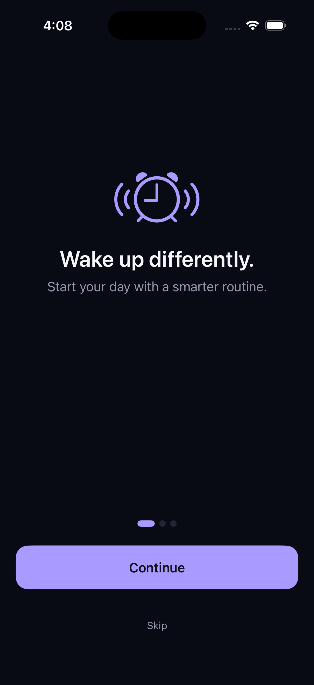
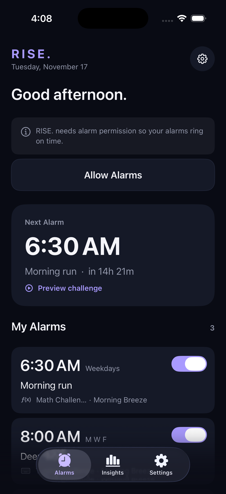
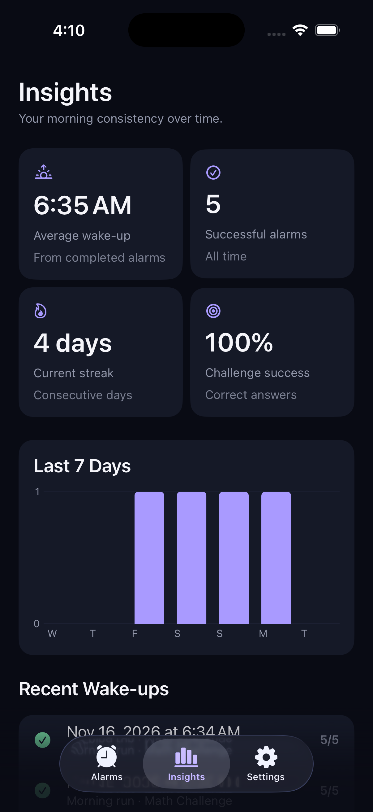
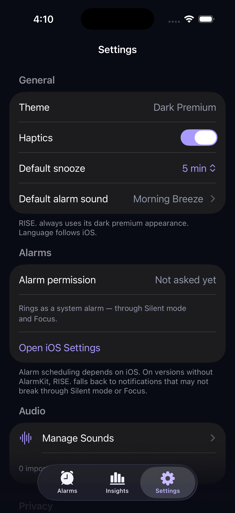
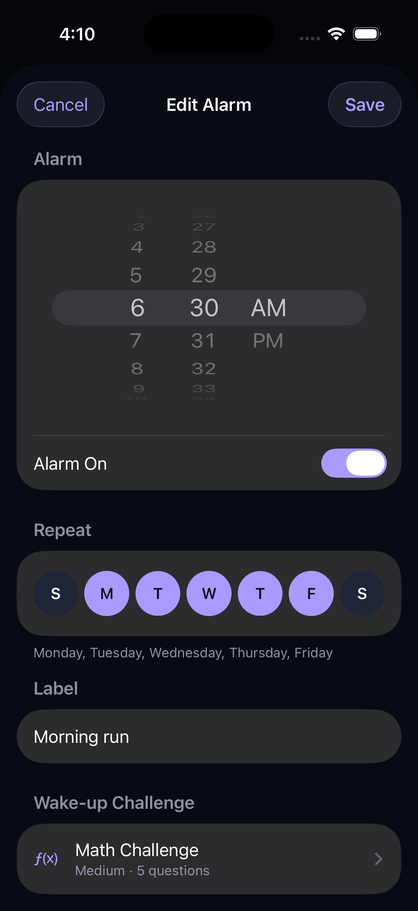
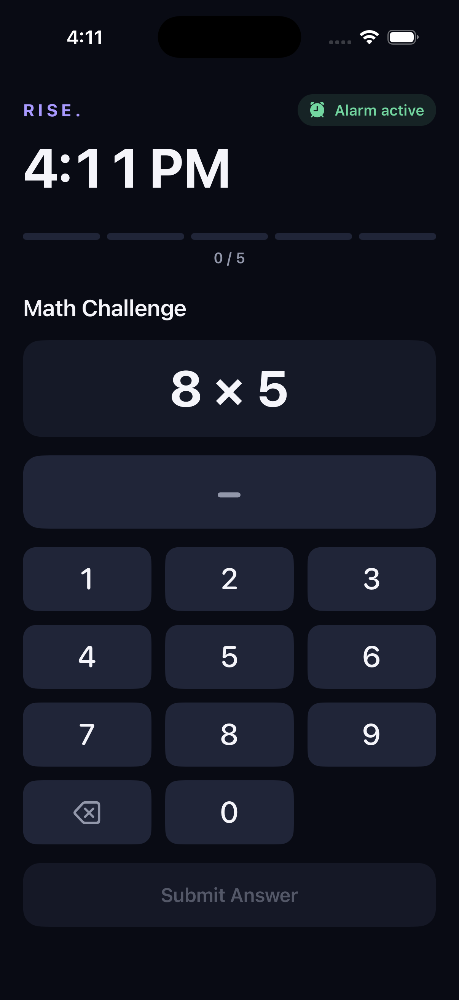

# RISE. — iOS Alarm App

> Wake up. Think. Get up.

[](https://github.com/Borwon/rise-ios/actions/workflows/ios-build.yml)

Native SwiftUI implementation of the RISE. design system (dark premium, offline-first,
challenge-based alarm clock).

> **Status:** the app compiles, installs and launches on the iOS 26 simulator through the
> GitHub Actions workflow in this repo, and the screenshots below are generated by that job.
> AlarmKit's real wake-up behaviour (ringing through Silent/Focus, post-restart, custom
> sound) still has to be verified on a physical iPhone.

## Screenshots

Captured automatically on every push by `.github/workflows/ios-build.yml`.

| Onboarding | Alarms | Insights |
|---|---|---|
|  |  |  |

| Settings | Alarm editor | Wake-up challenge |
|---|---|---|
|  |  |  |

## What is implemented

| Area | Status |
|---|---|
| Design system (colors, spacing, radius, components) | Done |
| Alarms: create / edit / enable / disable / delete / repeat days | Done |
| Persistence (SwiftData, local only, no account) | Done |
| Alarm scheduling: AlarmKit on iOS 26+, notification fallback below | Written, untested on device |
| Math / Typing / Memory challenges + configuration + demo | Done |
| Wake-up challenge flow + success screen | Done |
| Auto-start the challenge when the app opens after an alarm rang (15 min window) | Done |
| Missed wake-ups recorded for Insights | Done |
| Built-in sound catalogue, custom audio import (Files), preview, fallback | Done (no audio files bundled) |
| Insights (streak, average wake time, success rate, 7-day chart) | Done |
| Settings (default snooze, default sound, haptics, permissions, delete all data) | Done |
| Onboarding (3 pages) | Done |
| Widget extension (alarm Live Activity + status tile) | Written, untested on device |

## Requirements

- **Mac with Xcode 26** — the widget extension imports AlarmKit and needs the iOS 26 SDK.
- [XcodeGen](https://github.com/yonaskolb/XcodeGen) → `brew install xcodegen`
- App deployment target: **iOS 18.0**. Widget extension: **iOS 26.0** (iOS just does not
  load the extension on older versions).

## Build

```bash
cd "Rise Application"
xcodegen generate
open RISE.xcodeproj
```

Then pick your team in *Signing & Capabilities*, choose an iPhone running iOS 26, and run.

## Continuous integration (no Mac required)

`.github/workflows/ios-build.yml` runs on `macos-26` (Xcode 26 + iOS 26 SDK):

1. `xcodegen generate` → `RISE.xcodeproj`
2. `xcodebuild -scheme RISE -destination 'generic/platform=iOS Simulator'`
3. `simctl` boot / install / launch, then screenshots for each tab
4. uploads `build-log` and `screenshots` artifacts

The screenshot step passes debug-only launch arguments (see `RISE/App/LaunchOptions.swift`,
compiled out of Release builds):

| Argument | Effect |
|---|---|
| `-riseSeedDemoData` | Fills an empty store with sample alarms and a week of history |
| `-riseScreen alarms\|insights\|settings` | Skips onboarding and opens that tab |
| `-riseScreen editor` | Opens the alarm editor sheet |
| `-riseScreen challenge` | Opens a preview run of the wake-up challenge |

On a Mac those same steps work locally; `xcodebuild build` alone is usually enough.

## Before shipping

- **App icon:** `Assets.xcassets/AppIcon.appiconset` has no image yet (build warning). Drop a
  1024×1024 PNG named `AppIcon-1024.png` in that folder and add `"filename"` to its
  `Contents.json`.
- **Built-in sounds:** the five catalogue entries have no audio files. Preview falls back to
  a system tone, and alarms use the system sound. Add licensed files if you want them real.
- **Links:** Terms / Privacy point at `example.com` placeholders in `SettingsView`.

## AlarmKit notes (read before shipping)

- `NSAlarmKitUsageDescription` is set in `project.yml`.
- On iOS 26+ alarms are scheduled through `AlarmManager` (they break through Focus/Silent).
- On iOS 18–25 the app falls back to `UNCalendarNotificationTrigger`, which is a plain
  notification — **it does not bypass Silent mode or Focus**.
- An alarm that fires shows the system alarm UI. The RISE. challenge screen opens when the
  user opens the app from the alarm; iOS does not let an app force a full-screen challenge
  over the lock screen. This is a platform limit, not a bug — see section 10 of the design doc.
- Sound: the system alarm uses `.default`. Custom imported audio is used for in-app preview
  and for the notification fallback; AlarmKit sound resource support must be verified on device.
- Scheduling is idempotent per alarm id: the editor re-schedules on save, and enabled alarms
  are re-scheduled once per session on launch.
- The challenge opens when the app becomes active within 15 minutes of a scheduled time.
  "Preview challenge" on the alarm card runs the same screens but writes no history.
- A one-shot alarm turns itself off after a completed challenge, like a real alarm clock.

## Project layout

```
RISE/
├── App/                  RISEApp, RootView, AppState
├── DesignSystem/         RISETheme + reusable components
├── Features/
│   ├── Alarms/           Home dashboard, create/edit, draft, view model
│   ├── Challenges/       Math / Typing / Memory engines, flow, demo, success
│   ├── Audio/            Sound library, import, preview
│   ├── Insights/         Statistics + Swift Charts
│   ├── Settings/         Preferences
│   └── Onboarding/
├── Core/
│   ├── AlarmKit/         Scheduling abstraction (AlarmKit + notification fallback)
│   ├── Audio/            AVAudioPlayer preview, file import
│   └── Persistence/      SwiftData models + container
└── Resources/            Info.plist (generated), Assets.xcassets
RISEAlarmWidget/          Widget extension (AlarmKit Live Activity + status tile)
Shared/                   RiseAlarmMetadata, compiled into both targets
```

## What still needs a real device

1. AlarmKit authorization + scheduling behaviour, app suspended/terminated.
2. Behaviour after device restart.
3. Custom audio as an alarm sound (AlarmKit sound resource constraints).
4. Live Activity layout in the Dynamic Island and on StandBy.
5. VoiceOver + largest Dynamic Type pass on the challenge screen.
